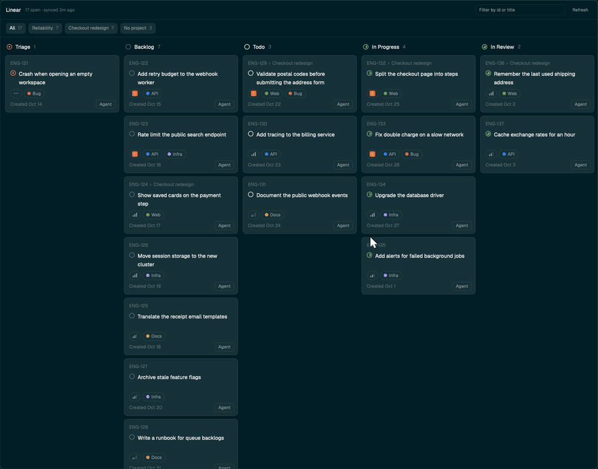
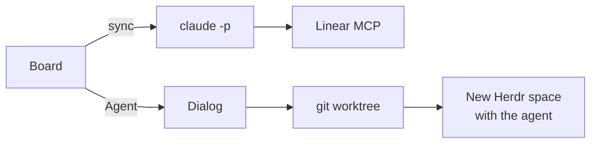
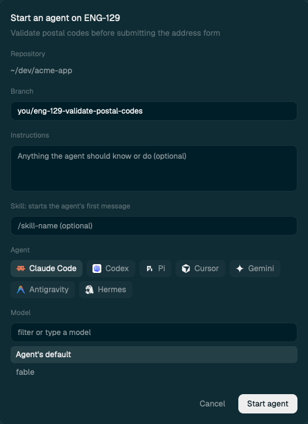

<div align="center">

# Linear board for Herdr

**Your Linear issues as a board inside [Herdr](https://herdr.dev). Press `Agent` on a card and a coding agent starts on it in a fresh git worktree.**

[](LICENSE)
[](https://herdr.dev/mods)
[](#requirements)



</div>

## Why

Picking up an issue usually means leaving the terminal, copying a branch name, making a worktree and
pasting the issue into an agent. Here it's one button, in the window your agents already live in.

## Features

| | |
|---|---|
| **Board** | One column per workflow state, most urgent issues first |
| **Project filter** | Buttons for every project you have issues in. Your choice is remembered |
| **Search** | Filter by id or title as you type |
| **Agent button** | Pick an agent, a model and a reasoning level, and start on Linear's suggested branch |
| **Instant open** | Issues are cached, so the board opens with no loading screen |
| **No API key** | Issues come from the Linear MCP through Claude Code |

## How it works



## Run an agent

Press `Agent` on a card to open the dialog:

<p align="center"></p>

| Field | What it does |
|---|---|
| **Repository** | The folder the worktree is made from: the team's repo if mapped, else the space you're in |
| **Branch** | Prefilled with Linear's suggested branch. An existing branch is checked out |
| **Instructions** | Anything the agent should know or do, for this issue only |
| **Skill** | Typed first in the agent's message, such as `/review` in Claude Code |
| **Agent** | One of the agents installed on that machine |
| **Model** | Pick one, type one, or keep the agent's default |
| **Reasoning** | The levels the chosen model supports |
| **Ask it to use subagents** | Adds that request to the agent's message |

Your agent, model, reasoning, skill and subagents choices are remembered for next time.

Press `Start agent`, and the mod:

1. Creates a worktree at `~/.herdr/worktrees/<repo>/<branch>`, from the fetched default branch.
2. Opens a new space there, with a tab named after the issue, and closes the board.
3. Starts your agent with the issue as its first message, asking it to read the issue, run the
   project's checks, push and open a PR. It is told not to merge or deploy.

Claude Code, Codex, OpenCode, Cursor, Pi and Gemini get model choices. Any other agent Herdr knows
starts with its own defaults.

## Requirements

- [Herdr](https://herdr.dev)
- The `claude` CLI, signed in, with the claude.ai Linear connector

Check the connector with:

```sh
claude -p "List my Linear issues"
```

## Install

Tell your coding agent:

```
Read ~/.config/herdr-app/AGENTS.md, then add this mod: https://github.com/nu0ma/herdr-linear-board
```

Or by hand:

```sh
git clone https://github.com/nu0ma/herdr-linear-board && cd herdr-linear-board
cp -R mods/linear-board mods/linear-board-agent ~/.config/herdr-app/mods/
```

Then add the key to the `global` section of `~/.config/herdr-app/keys.json`:

```json
"ctrl-shift-y": "mod.open:linear-board"
```

## Usage

| Action | Result |
|---|---|
| `ctrl-shift-y` | Open the board. Press it again, or `Esc`, to close it |
| Click a card | Open the issue in your browser |
| `Agent` on a card | Open the dialog, then `Start agent` |
| Project button | Show that project. `All` clears it |
| `Refresh` | Sync now |

## Configuration

`Agent` works from the folder of the space you're in, which must be inside a git repo. To make a
team always use one repo, create `~/.config/herdr-app/linear-board.json`:

```json
{ "repos": { "ENG": "~/dev/app", "OPS": "~/dev/infra" } }
```

## Good to know

- **Syncing costs a model run.** Each sync is one short `haiku` run on your Claude plan, so the board
  syncs at most every 30 minutes while open, or when you press `Refresh`. Issues can be up to that old.
- **The first open after starting Herdr takes a few seconds** while Herdr warms up the mod's code.
  Later opens are nearly instant.
- **Closing the board during a sync drops the result.** The next open syncs again.
- **80 cards at most.** Herdr limits how long a render may take, so past 80 cards each column says how
  many more it has. Filters reach the rest.
- **Assigned issues only**, up to 100 per state type, not completed or canceled.
- **Claude Code may ask to trust the new worktree.** Choose `Yes, I trust this folder`: the issue
  arrives as soon as you do. The default answer, `No, exit`, ends the session.
- **`Not a git repository`** means the space you're in isn't a repo. Open the board from one, or map
  the team as above.
- **`Linear MCP gave no answer`** means the connector isn't available to `claude -p`. Run the check
  under [Requirements](#requirements).

## What it touches

- **Network:** `claude -p` reaches Linear through its connector, and `git fetch` runs when an agent
  starts.
- **Programs:** `claude`, `sh`, `git`, the agents' CLIs (to list models) and your system's URL opener.
- **Files:** reads `~/.config/herdr-app/linear-board.json`; writes
  `~/.config/herdr-app/linear-board-issues.json` and the keys `linear-board.*` and
  `linear-board-agent.*` in Herdr's shared state; creates worktrees under `~/.herdr/worktrees`.
- **Agents:** an agent runs with whatever permissions its own config gives it. Issues are written by
  whoever filed them, and it is asked to read them, so take care with issues from outside your team.

## Develop

```sh
node --test
herdr-app check mods/linear-board && herdr-app check mods/linear-board-agent
```

[`RECIPE.md`](RECIPE.md) is the full brief: everything an agent needs to rebuild the mod from an
empty folder.

## License

[MIT](LICENSE). Built from [dantech99/herdr-linear](https://github.com/dantech99/herdr-linear) (MIT);
the agent dialog is adapted from `issue-agent` in
[obrunogonzaga/herdr-mods](https://github.com/obrunogonzaga/herdr-mods) (MIT).
