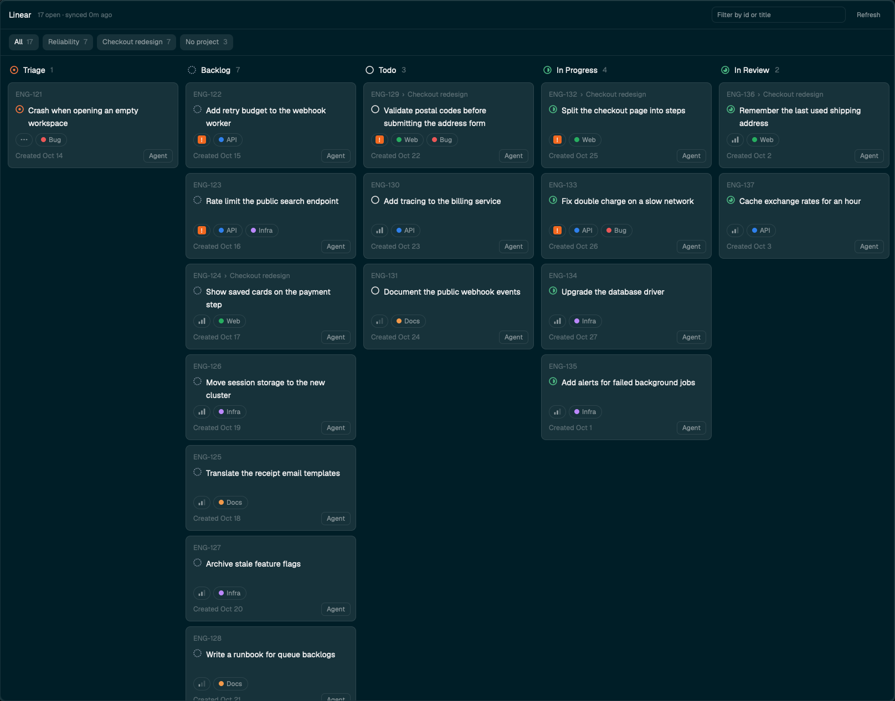

# Linear board

Your open Linear issues as a board of state columns, in a popup over the window (`ctrl-shift-y`).
Filter by project or text, click a card to open it in the browser, and press `Agent` on a card to
start a coding agent on it in a fresh git worktree. Issues come from the Linear MCP through
`claude -p`, so no API key is involved.

## What you see

**The board**: a popup at 94% of the window's width and 90% of its height, on the `background`
color, radius 10, a 1px `border`, base type 13px. Top to bottom:

- **Header**, 46px tall, 14px side padding, 10px gaps, a 1px `border` line under it: `Linear`
  semibold, `46 open · synced 3m ago` in 11px `dim`, then on the right a 220px filter field (26px,
  radius 7, placeholder `Filter by id or title`, its border `accent` while it holds text) and a
  `Refresh` button (11px `muted`, 26px tall, 8px side padding, radius 7, `hover` under the pointer).
- **Project buttons**, a wrapping row, 14px side and 8px vertical padding, 6px gaps, a 1px `border`
  line under it: `All`, then each project your issues are in, biggest first, `No project` last. Each
  is 26px tall, 9px side padding, radius 7, 11.5px, at most 320px with the name truncated, its count
  in `dim`. The chosen one is `selected`/`foreground`, the others `raised`/`muted`.
- **Columns**, side by side, each 280px wide with 12px between them; the row scrolls sideways when
  they don't fit, and each column scrolls down. Past 80 cards in all, a column ends with
  `12 more: filter to see them` in 11px `dim`. Column head, 34px: the state's icon at 14px, its
  name at 13px medium, the count in 12px `dim`.
- **Cards**, 8px apart, 12px side and 10px vertical padding, 6px between lines, radius 8, `raised`
  with a 1px `border`, `hover` under the pointer. Cards are the same height unless a title needs more:
  - `ENG-124 › Parent title` at 11.5px `dim`, the parent truncated.
  - The state icon at 14px beside the title at 13px, at least 42px tall: the whole title, never truncated.
  - A row of 22px pills with a 1px `border`, fully rounded: the priority, 28px wide, then up to
    three labels (8px side padding, 11px `muted`, an 8px dot in the label's color).
  - `Created Oct 28` at 11.5px `dim`.
  - An `Agent` button placed over the bottom right corner, 8px in: 22px tall, 8px side padding,
    radius 6, 11px `muted`, `raised` with a 1px `border`; `background` and `foreground` under the
    pointer. It takes no room, so it doesn't change the card's height.

State icons, 14×14, in `currentColor`: triage a ring with a dot (`#fc7840`), backlog a dashed ring
(`#95a2b3`), unstarted a ring (`#e2e2e2`), started a ring with a half disc and review a ring with a
three-quarter disc (both `#4cb782`). Priority: Urgent is a 14px `#f2681f` square, radius 3, with a
white bold `!`; High, Medium and Low are three rising bars in `muted`, one, two or none of them at
30% opacity from the right; none is three short dashes.

In place of the columns: `Loading issues…` beside an 18px spinner, centered, while there's nothing
to show yet; else `No open issues assigned to you`, `No issues match this filter`, or the error in
`ansi1`. An error while issues are showing is a line in 11px `ansi1` above the columns.

**The agent dialog** (480×660, `popover` background, 16px padding, sections 14px apart, each titled
in 11px `dim`). The title block and the footer stay; the sections between them scroll:

- `Start an agent on ENG-123` at 14px semibold, the issue title under it in `dim`, truncated.
- **Repository**: the folder the worktree is made from (and `· <machine>` for a remote space) in
  `muted`; `No folder: open a space in a git repo` in `ansi1` when there is none.
- **Branch**: a 30px input, radius 8, prefilled with Linear's suggested branch, else
  `<identifier>-<first five title words>`.
- **Instructions**: a textarea, 3 rows growing to 8, placeholder
  `Anything the agent should know or do (optional)`.
- **Skill: starts the agent's first message**: a 30px input, placeholder `/skill-name (optional)`,
  prefilled with the last skill used.
- **Agent**: a wrapping row of 26px chips, one per installed agent with its icon at 14px.
- **Model** (only for agents it knows): a filter input, then a 150px scrolling list. First row
  `Agent's default`, which reads `Use "<typed text>"` when the filter matches no model.
- **Reasoning**: chips of the levels the chosen model supports.
- **Options**: one chip, `Ask it to use subagents`.
- Footer: the error in 11px `ansi1` on the left, `Cancel` and a `Start agent` button in `solid`
  (`Starting…` while it works).

## How it behaves

- It doesn't show agent statuses: it lists Linear issues, not agents. Only the spinner moves.
- It loads issues assigned to you in the triage, backlog, unstarted and started states, up to 100 of
  each. Columns are the states that have issues, ordered triage, backlog, unstarted, started,
  review, where review is a started state with "review" in its name. In a column: Urgent, High,
  Medium, Low, then no priority. At most 80 cards show, shared out one at a time across the columns,
  and filters reach the rest. The counts always cover every issue.
- Every open is a new copy of the mod, but both mods reuse the view class from the first open, so
  only that first open pays for cold code. The issues are kept in shared state (`linear-board.snapshot`),
  so they show at once. It then reads `~/.config/herdr-app/linear-board-issues.json` and takes that
  when it's newer.
- It syncs when there is nothing newer than 30 minutes, every 30 minutes while open, and on
  `Refresh`. Issues stay on screen during a sync; `Refresh` turns into a 13px spinner. A second
  request during a sync is ignored.
- The project buttons are counted from all your issues. The chosen project is kept in shared state
  (`linear-board.project`) and survives closing and restarting; `All` clears it. A project that no
  longer has issues counts as `All`. The text field filters as you type, by identifier and title,
  case-insensitively, together with the project, and resets when the board reopens.
- A click on a card opens the issue on this computer: `open` on macOS, `explorer` on Windows,
  `xdg-open` elsewhere. Only `https:` links are opened.
- `Agent` opens the dialog without opening the browser. The repository is the team's folder in
  `~/.config/herdr-app/linear-board.json` (`{ "repos": { "<TEAM KEY>": "~/dev/repo" } }`, on this
  computer) when the issue's team is mapped, else the focused pane's folder (else the focused
  terminal's, else the shown space's folder) on that space's machine.
- In the dialog, Enter in the branch field starts. A branch that is empty, starts with `-` or fails
  `git check-ref-format --branch` is refused with its reason. Start makes a worktree at
  `~/.herdr/worktrees/<repo>/<branch, slashes as dashes>` on that machine, branching from
  `origin/<default branch>` after a fetch, or from `HEAD` without an origin; an existing branch is
  checked out instead. Then `space.new` opens it with a tab named after the identifier, `argv` the
  agent's command plus its model and reasoning flags, and `task` one line: the identifier, title and
  URL, an ask to read the full issue, to follow AGENTS.md/CLAUDE.md, run lint, typecheck and tests,
  push and open a PR that mentions the identifier, and not to merge or deploy. With the subagents
  option on, it also asks the agent to delegate. A skill comes first in the task as typed;
  instructions follow as `Instructions: …`. The new space is shown, and the dialog and the board
  both close.
- The dialog remembers the last agent, model, reasoning, subagents choice and skill (shared
  `linear-board-agent.last`) and caches each machine's model lists for an hour (shared
  `linear-board-agent.models`).
- `mod.open` while the board is open closes it, so its key is a toggle. A second `mod.open` starts a
  second copy, which closes the first and itself. The open overlay id is kept on `globalThis`.
- Command: `linear-board.refresh` syncs. It reaches shown copies only.

## Built from

- `mods/linear-board/main.js`: the board, a `View`, default export. It makes one `Card` for each
  card on show with `cx.new`, from `init`, event handlers and tasks, never during render. `mod.json`:
  `{ "place": "none", "title": "Linear board", "overlay": { "width": 0.94, "height": 0.9 } }`.
- `mods/linear-board/sync.js`: pure `SYNC_TOOLS`, `SYNC_PROMPT`, `parseSync`, `parseRepos`,
  `NO_PROJECT`. The sync runs, in the home folder, with stdin closed:
  `claude -p <prompt> --model haiku --output-format stream-json --verbose --tools "" --allowedTools
  <the two list_issues tools> --no-session-persistence`, through `sh -c`, after unsetting
  `CLAUDECODE` and `CLAUDE_CODE_*`. The prompt asks for four parallel `list_issues` calls, one per
  state type, with assignee `me`, limit 100 and the fields id, title, url, priority, createdAt,
  status, statusType, labels, team, project, parentId, gitBranchName. `parseSync` reads the issues
  from the tool results in the stream, so nothing passes through the model.
- `mods/linear-board/card.js`: `Card`, a `View` retained as a child of the board, updated with
  `set_props`; `stateIcon`; and `board`, the team folders and overlay id its buttons need.
- `mods/linear-board/board.js`: pure `STATE_COLORS`, `stateKind`, `boardColumns`, `limitCards`,
  `projectsOf`, `filterIssues`, `shortDate`, `ago`.
- `mods/linear-board/urls.js` (`safeUrl`: https only) and `open.js` (`openUrl`, by
  `window().platform`).
- `mods/linear-board/*.svg`: the state and priority icons and `spinner.svg`, turned with `.spin(900)`.
- `mods/linear-board-agent/`: the dialog, a `View` opened with `openOverlay({ mod:
  "linear-board-agent", kind: "dialog", width: 480, height: 660, props: { issue, cwd, on, board } })`,
  where `board` is the overlay to close after a start.
  `task.js`: pure `branchFor`, `folderName`, `worktreeFolder`, `branchProblem`, `taskFor`.
  `agents.js`: one adapter per CLI (Claude Code, Codex, OpenCode, Cursor, Pi, Gemini) for listing
  models and building flags. From `linear-agent` in dantech99/herdr-linear, adapted from `issue-agent`
  in obrunogonzaga/herdr-mods.
- `keys.json`: `{ "global": { "ctrl-shift-y": "mod.open:linear-board" } }`.
- `herdr` functions: `spaces`, `panes`, `focused`, `exec`, `theme`, `home`, `appHome`, `window`,
  `readTextFile`, `writeTextFile`, `nextCommand`, `openOverlay`, `closeOverlay`, `props`,
  `knownAgents`, `run`, `shared`, `setShared`.
- Reaches the network through `claude -p` and `git fetch`. Runs `claude`, `sh`, `git`, the agents'
  CLIs and the system's opener. Writes `linear-board-issues.json` and worktrees under
  `~/.herdr/worktrees`.

## Watch out

- Each sync is a model run on the person's Claude plan, which is why the board syncs rarely and
  never on a short timer.
- `claude -p` needs the claude.ai Linear connector. The prompt names
  `mcp__claude_ai_Linear__list_issues`; a setup with another tool name needs `SYNC_TOOLS` changed.
- Inside a running Claude session the environment carries markers that break a nested `claude -p`:
  unset them first. Leaving stdin open makes it wait.
- A mod can't import another mod's files. The folders share nothing but the `props` of the dialog.
- A render has a time budget. Drawn inline, 24 full cards overrun it: the view shows `interrupted`
  and stays on its last good frame, which here was the spinner. `herdr-app check` passes all the
  same, so test with many cards. As child views each card has its own budget, but about 200 still
  overrun the board's render, so it shows 80 and only makes the views it shows: making them all at
  once overruns too.
- Cold code freezes the window. Herdr's JIT (`rquickjs_jit`) copies its whole feedback table as a
  function's call count reaches 1, 2, 4 … 64, about 70 to 140 ms a time on the main thread, and every
  open evaluates the module again. A board's first render does that dozens of times, so each open
  froze the window for 4 to 6 s, with little to do with the card count. `globalThis` outlives a copy,
  so each `main.js` exports the first class it stored there, as long as the source matches. Building
  the cards in batches made it worse: more renders of cold code. `Date.now()` marks show the delay on
  whatever happened to run, so profile with `sample <pid>` during the freeze.
- `uniform_list` and `v_virtual_list` can't hold handlers inside a row, so they can't carry the
  `Agent` button. Sizes given to `v_virtual_list` also ignore the app's zoom.
- The MCP gives no state colors and no label colors: states use Linear's defaults by kind, and a
  label's color is picked from its name.
- A sync still running when the popup closes is cancelled, and its result is lost.
- Closing the popup and reopening starts a new copy: anything that must survive goes in shared state.
- `task` is typed into the agent as one line: every text in it has control characters and runs of
  whitespace replaced by one space.
- The issue's description isn't loaded, so the task asks the agent to read the issue itself.
- Mapped `repos` folders are on this computer; leave a team unmapped for a remote space.
- A worktree is a new folder, so Claude Code can stop at its trust prompt before the first message.
  The task waits and arrives once the person chooses `Yes, I trust this folder`. Enter alone picks
  the default, `No, exit`.
- `Agent` from a folder outside a git repo fails with `Not a git repository`.

## Done when

- `herdr-app check mods/linear-board` and `herdr-app check mods/linear-board-agent` pass.
- `node --test` passes.
- With 400 issues in the snapshot the board opens without `interrupted`, shows 80 cards and says how
  many more each column has.
- Pressing `ctrl-shift-y` with the board open closes it.
- `ctrl-shift-y` opens the board with your issues in state columns, with a spinner until the first
  sync ends.
- Reopening it shows the issues at once, with no spinner and no sync, and the window doesn't freeze.
- A project button narrows the columns to that project, and it is still chosen after reopening.
- Clicking a card opens the issue in the browser.
- `Agent` on a card, from a space inside a git repo, Claude Code, `haiku`, `low`, Start: a new space
  opens on `~/.herdr/worktrees/<repo>/<branch>`, its tab is named after the identifier, the task is
  the agent's first message, and the board has closed.
